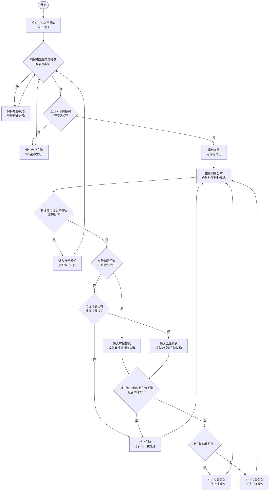

## 每次发言注意事项
 - 每次发言前必须说:Hi I am Claude,我已经阅读完次工程的CLAUDE.md文件

## 修改工程注意事项
 - 只有你明确收到:(允许修改)这几个字时你才可修改工程文件或代码
 - 禁止私自修改工程文件,在你修改工程文件之前你必须得到准确的用户指令,且必须满足下一条要求
 - 如果你获取到了修改工程文件的命令,你必须反问回答以下内容发给用户:我是Claude我现在得到了修改工程的命令,请你再次确认命令是否有误,你需要再次得到肯定的命令才可开始修改工程文件
 - 没有收到明确指令不能修改工程文件
 - 终端报错信息你只管解答即可,不需要你去修改工程
 - 只有你明确收到:(允许修改)这几个字时你才可修改工程文件或代码,且每次在正式开始修改工程时你必须再次征求我的意见,征求意见发送如下文本内容,我是Claude根据你的规则我现在要在工程或代码文件进行修改,请你确认我是否可以执行对应操作,随后你再根据我的回复内容做出对应的判断

## 关于工程项目背景和硬件连线图的问题
 -  项目的硬件连线图在本地路径为:D:\_Project\GD32_Control\新设计要求\AI总结分析报告 的下名为: GPT软件开发硬件说明_修正版.md  的文件是硬件连线图
 

## 硬件信息
 - MCU主控芯片为:GD32E230
 - 无线发送数据模块: PH2119BBA
 - 无线接收数据模块: PH2219BBA

## 任务需求
 - 发送方: 遥控器使用PH2119BBA发送数据,数据内容用于控制接收方执行对应上升或下降的动作
 - 接收方: 控制器使用PH2219BBA接收遥控器PH2119BBA发送来的数据,并解析对应的内容且执行相应的如上升或下降的动作

## 代码错误相关排查思路
 - 如果是无线发送模块驱动出现问题可能问题如下:相关驱动和应用层文件是移植的CMT2300A芯片的驱动文件,主控MCU芯片为STM32F103VC,而本项目使用的主控芯片为GD32E230,无线发送数据芯片是CMT2119B,具体移植文件排查事项参考文件路径如下D:\_Project\GD32_Control\移植文件注意事项\CMT2119B_GD32E230_移植排障注意事项.md
 - 如果是无线如果是无线发送模块驱动出现问题可能问题如下相关驱动和应用层文件是移植的CMT2300A芯片的驱动文件,主控MCU芯片为STM32F103VC,而本项目使用的主控芯片为GD32E230,无线发送数据芯片是CMT2219B具体移植文件排查事项参考文件路径如下D:\_Project\GD32_Control\移植文件注意事项\CMT2219B_GD32E230_移植排障注意事项.md
 - 无线接收发数据芯片CMT2119B和CMT2219B的数据手册位于本地路径:D:\_Project\GD32_Control\移植文件注意事项\无线收发芯片数据手册,如有需要可以再次查看数据手册

## 回答问题注意事项
 - 先给结论
 - 禁止长篇大论,不要说废话绕弯子,尽量简洁回答且通俗易懂
 - 所有的问题必须结合依据我的项目来进行回答

 ## 解释代码时的注意事项
 - 先给结论,不要做铺垫,也不要重复性解释,除非用户进行追问,用户问什么就答什么
 - 对代码进行讲解的时候禁止长篇大论,必须简短通俗易了的回答,且说大白话,不能绕弯,用户有不了解的地方会找你追问你重新讲解
 - 对于代码中的函数,你需要先告诉用户这是什么函数,例如BSP板载库函数,官方库函数,或者说用户自定义函数,只需要回答这是什么函数即可
 - 对于C语言自带的关键字,你不需要做出解释

## 生成代码注意事项
 - 比如说使用代码中使用到了如GPIO,SPI,UART,I2C等,需要提前开启对应时钟
 进行初始化配置的代码时,你需将配套的初始化过程也一并提示出来
 - 如果有可以直接使用的函数或者例如配套的封装函数,优先使用现成的,禁止手搓 

# 代码具体实现流程图
有线 / 无线升降控制流程说明
这份说明对应已经确认的完整流程图，包含文字步骤和 Mermaid 流程图代码。阅读下面的步骤能看清每个判断的去向和返回位置。

## 一、这个流程要做什么

通过有线端或无线端的按键，控制设备上升、下降和停止。有线端和无线端都有急停按钮。

判断顺序是：**先看急停，再看有线，最后看无线。**

## 二、先把这几个规则说清楚

1. **上电先停止。** 初始化为急停模式，不直接进行升降。
2. **任何一端按下急停，都立即停止升降。** 有线急停、无线急停，只要有一个按下，就进入急停模式。
3. **退出急停前，要先松开按键。** 有线和无线急停按钮必须都松开，并且两端的上升、下降按键也都松开，才退出急停。退出后仍保持停止，重新按升降按键才操作。
4. **有线优先。** 有线端有升降按键按下，就选有线端。只有有线端没有升降按键按下，才继续看无线端。
5. **只看选中这一端的升降按键。** 进入有线模式后看有线按键；进入无线模式后看无线按键。两种模式都必须进入同一个升降判断。
6. **同一端上升、下降同时按下，就停止。** 即使有线端同时按下两个键，也不能跳过有线端，改用无线端执行升降。
7. **两端都没有升降按键按下，就停止。** 按住有效的升降按键时继续操作；两端按键都松开时停止。若有线按键松开时，无线端仍有有效按键按住，下一轮按有线优先的顺序重新选择。
8. **每次执行后，都要回去重新判断。** 上升、下降或停止执行一次后，均返回模式判断，并先检查急停。

这里的“有升降按键按下”，包括只按上升、只按下降，以及两个键同时按下。两个键同时按下的情况，交给后面的升降判断处理。

## 三、完整步骤和每一步的去向

下面的编号和后面 Mermaid 代码中的编号一一对应。

| 编号 | 做什么或判断什么 | 接下来去哪里 |
| --- | --- | --- |
| 01 | 开始。 | 进入 02。 |
| 02 | 初始化为急停模式，停止升降。 | 进入 03。 |
| 03 | 有线和无线急停按钮是否都松开？ | 是：进入 05。否：进入 04。 |
| 04 | 保持急停状态，继续停止升降。 | 返回 03，继续检查急停按钮。 |
| 05 | 有线、无线两端的上升和下降按键是否都松开？ | 是：进入 07。否：进入 06。 |
| 06 | 继续停止升降，等待按键松开。 | 返回 03，重新检查急停按钮，再检查升降按键。 |
| 07 | 退出急停，先保持停止。 | 进入 08。 |
| 08 | 重新判断当前应该处于何种模式。 | 进入 09，先检查急停。 |
| 09 | 有线或无线急停按钮是否按下？ | 是：进入 10。否：进入 11。 |
| 10 | 进入急停模式，立即停止升降。 | 返回 03，等待急停按钮和升降按键全部松开。 |
| 11 | 有线端是否有升降按键按下？ | 是：进入 12。否：进入 13。 |
| 12 | 进入有线模式，读取有线端升降按键。 | 进入 16，进行升降判断。 |
| 13 | 无线端是否有升降按键按下？ | 是：进入 14。否：进入 15。 |
| 14 | 进入无线模式，读取无线端升降按键。 | 进入 16，进行升降判断。 |
| 15 | 停止升降，等待下一次操作。 | 返回 08，继续检查急停和升降按键。 |
| 16 | 选中这一端的上升和下降是否同时按下？ | 是：进入 15。否：进入 17。 |
| 17 | 上升按键是否按下？ | 是：进入 18。否：进入 19。 |
| 18 | 执行相关函数，进行上升操作。 | 返回 08，重新判断模式。 |
| 19 | 执行相关函数，进行下降操作。 | 返回 08，重新判断模式。 |

## 四、几个容易看错的地方

- **12 和 14 都接到 16。** 有线模式和无线模式都要先判断两个升降按键是否同时按下，不能直接执行升降，也不能直接绕回模式判断。
- **15 一定要返回 08。** “等待下一次操作”是先停止升降，再继续检查按键，不是停在这个步骤里不再判断。
- **06 返回的是 03。** 等待升降按键松开时，也要继续检查急停按钮。
- **17 的“否”为什么可以直接下降：** 前面已经确认选中这一端至少有一个升降按键按下，并排除了上升、下降同时按下。所以此时上升键没有按下，就代表下降键按下。
- **18 和 19 执行后都返回 08。** 不在升降函数里一直等待按键松开；每轮都重新检查急停和当前按键，再决定继续升降还是停止。
- **正常停止和急停不同。** 没有升降按键按下，或者选中这一端的两个升降按键同时按下，都进入 15；急停按钮按下才进入 10。

## 五、Mermaid 流程图代码

“执行相关函数”沿用原图的说法，表示执行对应的升降操作，没有指定具体函数名。这份文件描述的是控制流程，没有规定硬件引脚、按键电平、通信方式或执行周期。

 